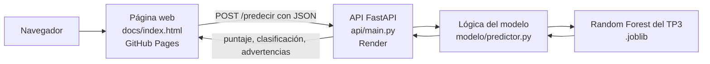

# Foco Vial | TP4 · Siniestros viales en CABA

**Equipo:** Matías Chiffone Guarde, María Candelaria Terán Ortiz y Olivia Vella Delgado · ITBA · Ciencia de Datos Aplicada.

Herramienta académica que **clasifica la severidad registrada de un siniestro que ya ocurrió** (leve contra grave o mortal) usando el Random Forest del TP3. No predice la ocurrencia de accidentes, no demuestra causalidad y **no sirve para decidir la atención de emergencias**.

- **Página web:** `https://USUARIO.github.io/foco-vial/`
- **API (documentación interactiva):** `https://COMPLETAR.onrender.com/docs`

> La API está en el plan gratuito de Render: si estuvo 15 minutos sin uso, la primera consulta tarda cerca de un minuto mientras el servicio despierta. La página lo avisa con el mensaje "Despertando la API".

## Cómo funciona



Cada pieza tiene una sola responsabilidad:

| Archivo | Responsabilidad | Dónde corre |
| --- | --- | --- |
| `docs/index.html` | Formulario y visualización. No tiene el modelo: solo le habla a la API por HTTP | GitHub Pages |
| `api/main.py` | Recibe los pedidos, valida los datos y devuelve errores claros. No sabe cómo funciona el modelo por dentro | Render |
| `modelo/predictor.py` | Arma las 16 variables del modelo a partir de los datos crudos (igual que en el TP3), aplica el pipeline y el umbral | Render, dentro de la API |

La página y la API están en dominios distintos, así que la API habilita **CORS** para que el navegador permita la consulta. Por defecto acepta cualquier origen: la API es pública, no usa cookies ni guarda datos. Para restringirla, definir en Render la variable `CORS_ORIGINS="https://USUARIO.github.io"`.

## Entradas y salidas

**Entrada** (`POST /predecir`):

```json
{
  "fecha": "2025-03-15",
  "hora": 3,
  "comuna": 14,
  "tipo_de_via": "AUTOPISTA",
  "modo_victima": "PEATON",
  "contraparte": "AUTO",
  "latitud": null,
  "longitud": null
}
```

`comuna`, `latitud` y `longitud` son opcionales. Las categorías válidas de vía, víctima y contraparte se consultan en `GET /info`. La API calcula sola día de semana, fin de semana, franja horaria, hora cíclica, mes y estación. **Nunca se pide la gravedad ni el número de víctimas.**

**Salida:**

```json
{
  "puntaje_gravedad": 0.710906,
  "umbral": 0.5,
  "clasificacion": "GRAVE_O_MORTAL",
  "etiqueta": "Alerta de gravedad",
  "asociaciones_generales": ["Peatones: mayor severidad observada en el EDA histórico.", "Autopistas: mayor proporción histórica de graves o mortales que en calles."],
  "advertencias": [],
  "modelo": "Random Forest",
  "version_modelo": "tp3"
}
```

**Errores:** comuna fuera de 1 a 15, hora fuera de 0 a 23, fecha inválida, categoría desconocida o campos de más devuelven **422** con el motivo. Si el modelo no se puede cargar, **503**. Coordenadas fuera de CABA o datos faltantes no frenan la evaluación: se agrega una advertencia. La página también valida antes de enviar (fecha, coordenadas incompletas) y muestra en castellano los errores que devuelve la API.

### Los tres ejemplos de la página

| Ejemplo | Puntaje | Resultado |
| --- | --- | --- |
| Peatón en autopista, 3 h, comuna 14 | 0,71 | Alerta de gravedad |
| Auto contra auto en calle, 15 h, comuna 6 | 0,17 | Leve |
| Registro incompleto (sin comuna, víctima ni contraparte) | 0,05 | Leve, con advertencias por datos faltantes |

En cada resultado, "Ver lo que viajó entre la página y la API" muestra el JSON enviado y la respuesta recibida.

## El modelo

Random Forest del TP3 (50 árboles, profundidad 12, hojas de al menos 10 casos, `class_weight='balanced_subsample'`), elegido por mayor F1 en validación cruzada sobre 2019 a 2024 (0,236 contra 0,202 de la regresión logística). Se verificó que el archivo `.joblib` reproduce exactamente los resultados del TP3 en el test temporal 2025:

| Recall | Precisión | F1 | PR-AUC | ROC-AUC |
| --- | --- | --- | --- | --- |
| 0,584 | 0,130 | 0,213 | 0,153 (2,3 veces la prevalencia de 0,066) | 0,721 |

Detectó 454 de los 777 siniestros graves o mortales de 2025, con 3.027 falsas alarmas sobre 10.973 leves.

## Correrlo en la computadora

Usar **Python 3.11 o 3.12**. Desde la carpeta del proyecto:

```bash
python -m venv .venv
source .venv/bin/activate          # Windows: .venv\Scripts\Activate.ps1
python -m pip install -r requirements.txt
```

Primera terminal, la API (documentación en `http://127.0.0.1:8000/docs`):

```bash
uvicorn api.main:app --reload
```

Segunda terminal, la página:

```bash
cd docs
python -m http.server 8080
```

Abrir `http://localhost:8080`. Cuando la página corre en la computadora, usa sola la API local (`http://127.0.0.1:8000`).

Pruebas automáticas (12 tests, no necesitan servidores encendidos):

```bash
python -m pytest -q
```

## Publicarlo en internet (gratis)

Requisitos: una cuenta de GitHub y este repositorio **público**.

**1. API en Render**

1. Entrar a [render.com](https://render.com) con la cuenta de GitHub. Al dar permisos, elegir **Only select repositories** y marcar solo este repositorio.
2. **New → Blueprint** y elegir este repositorio. Render lee `render.yaml` (plan Free, Python 3.12, `requirements-api.txt`).
3. Esperar el primer deploy y abrir `https://<nombre>.onrender.com/health`. Tiene que responder `{"estado": "ok", ...}`.

**2. Conectar la página con la API**

En `docs/config.js`, reemplazar `https://COMPLETAR.onrender.com` por la dirección de Render (sin barra al final) y guardar el cambio en GitHub.

**3. Página en GitHub Pages**

1. En el repositorio: **Settings → Pages**.
2. En **Source**, elegir **Deploy from a branch**; en **Branch**, `main` y la carpeta **`/docs`**. Guardar.
3. En uno o dos minutos la página queda en `https://<usuario>.github.io/<repositorio>/`.

**4. Prueba final:** abrir la página desde un celular, esperar el indicador "API conectada" y correr los tres ejemplos.

## Límites y próximos pasos

- **Muchas falsas alarmas:** la precisión es del 13%. Sirve para priorizar, no para decidir sola.
- **Puntaje sin calibrar:** por el balanceo de clases, no es una probabilidad real de lesión grave.
- **Faltantes:** el modelo conserva categorías `SIN_DATO`, que reflejan cómo se carga el registro (los leves llegan más incompletos) y no riesgo vial.
- **Sin exposición:** no hay datos de tránsito, velocidad ni clima.
- **Devolución del TP3, pendiente para el reentrenamiento:** agrupar categorías raras dentro del pipeline (hoy se agrupan antes del split), ampliar y justificar la búsqueda de hiperparámetros, elegir el umbral con la curva precision-recall sin usar 2025, y profundizar la interpretación de coeficientes y de `SIN_DATO`.

## Estructura

```text
docs/index.html              página web (GitHub Pages publica esta carpeta)
docs/config.js               dirección de la API publicada
api/main.py                  endpoints, validación, errores y CORS
modelo/predictor.py          variables derivadas e inferencia
modelo/*.joblib              pipeline entrenado en el TP3
modelo/metadata.json         métricas, umbral e hiperparámetros
tests/                       12 pruebas y 5 casos de referencia
requirements.txt             todo, para correrlo en la computadora
requirements-api.txt         dependencias de la API (Render)
render.yaml                  configuración de Render
guion/PRESENTACION_TP4.md    guion de la exposición
app/                         interfaz anterior en Streamlit (respaldo local, no se publica)
```

La interfaz anterior en Streamlit queda como respaldo: con la API encendida, `streamlit run app/app.py` la abre en `http://localhost:8501`.
